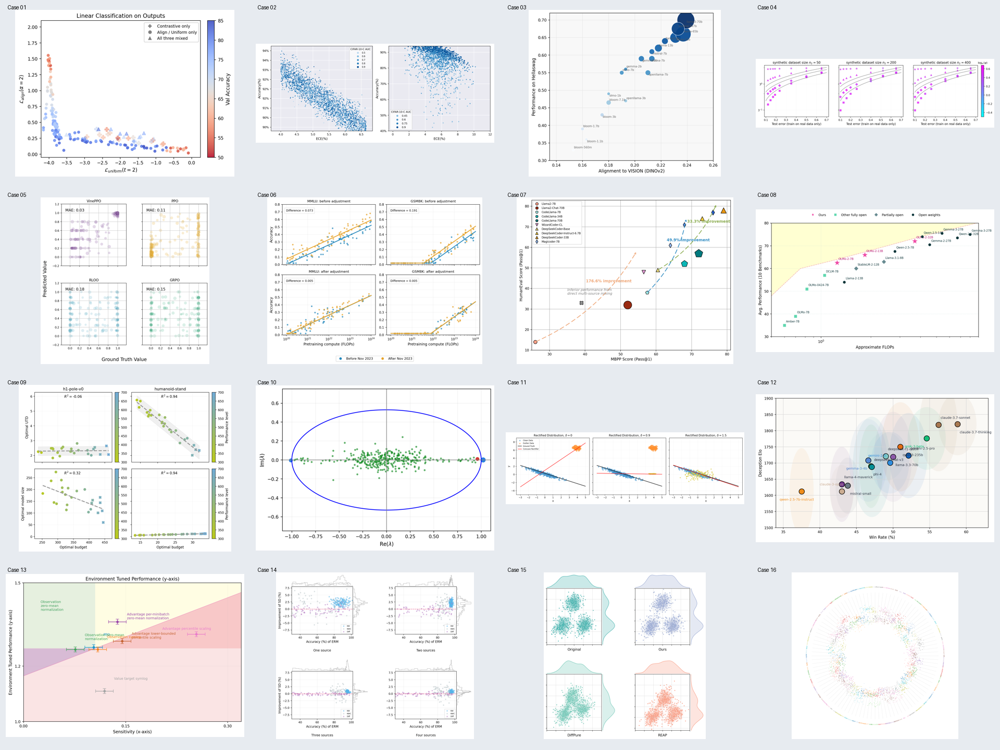

# 16 个散点图风格示例

默认使用模拟数据，用于演示样式，不是原论文实验结果。

```bash
python -m pip install -r requirements.txt
python render_all.py
```

只运行一个示例：`python case_01/code.py`。

case_01 至 case_16 分别对应 16 个示例，每个目录有 code.py 和 picture.png。实际绘图及数据集中在 render_all.py 的 case01() 至 case16() 函数中，修改对应函数中的数据即可。

## 旧版报告打包脚本

build_delivery.py 是原包附带的报告和 HTML 打包工具，不是绘图必需。它依赖未随压缩包提供的论文来源索引 JSON，并保留旧环境的绝对路径；本次未补造索引或运行该脚本。

若需要使用，先准备索引并调整输入输出路径，再安装额外依赖：

```bash
python -m pip install -r requirements-delivery.txt
```

该工具会重写 README 和各案例入口，并生成报告及压缩包，运行前请检查输出路径。


