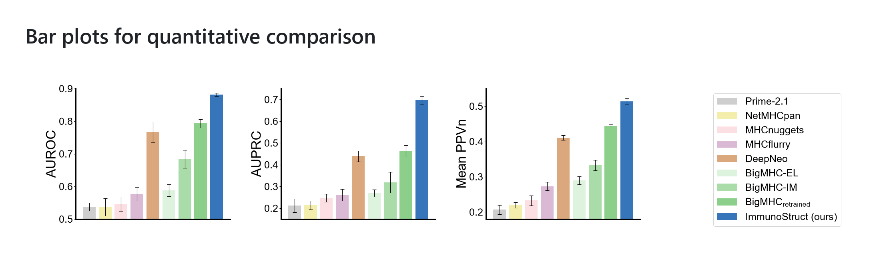

# 柱状图

运行 `python reproduce_bar_chart.py`，输出至 `bar_chart_output/`，包括 PNG、PDF、SVG。

脚本含中文注释。修改顶部 MODELS 可自定义每个模型的三个柱子：

```python
values=[0.538, 0.212, 0.207]  # AUROC、AUPRC、Mean PPVn
errors=[0.012, 0.031, 0.013]  # 对应误差线的半长度
```

color 控制颜色，PANELS 控制纵轴范围与刻度，FONT_FAMILY 和 TITLE_FONT_FAMILY 控制字体。数值超出纵轴时需调整范围。

默认数值为参考图估读值，误差的统计含义未确定；正式使用请换成真实数据。默认纵轴为截断坐标轴。


